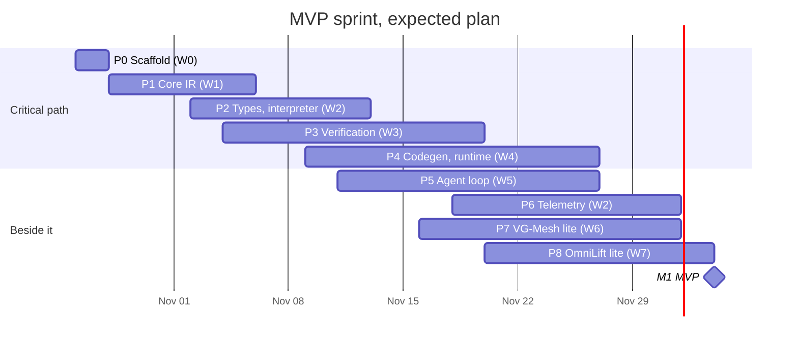
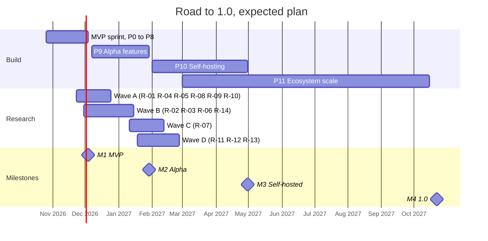

# ROADMAP

Expected plan for an agent-only build starting Monday 26 October 2026. Starting later? Shift every date by the same number of days. A gate passes only when `make gate-gN` exits 0 **and** the owner approves `reports/gate-gN.md`.

**Assumptions:** up to six build agents in parallel after G0; one extra agent per active research track; the owner reviews each gate within a day; no research track blocks a milestone. **Best case** (eight build agents, no failed gate): M1 in about three weeks. Each failed gate costs a few days.

**Critical path:** P1 core IR → P2 types and interpreter → P3 verification → P4 codegen. Everything else runs beside it.

## Milestones

| Milestone | Expected date | Done when |
| --- | --- | --- |
| M1 · MVP (v0.1) | 2026-12-04 | The audio limiter goes from its plain-language request (examples/audio_limiter.prompt.md), through the hosted loop, to verified binaries on three targets |
| M2 · Alpha (v0.2) | 2027-01-29 | Alpha features pass the G1–G8 suites; overhead within 5% of C; at least six research tracks reported |
| M3 · Self-hosted | 2027-04-30 | BLAKE3(vgc2) == BLAKE3(vgc3), and diverse double-compiling agrees |
| M4 · 1.0 | 2027-10-22 | Format v2 frozen; a public Mesh in the shape R-12 recommends; every doc example and the synthesis skill verified in CI |

## MVP sprint

## Road to 1.0

## Gates

| Gate | Phase | Passes when |
| --- | --- | --- |
| G0 | Scaffold | The workspace builds on macOS ARM64 and Linux x86_64, CI is green, and the spec docs are in the repo |
| G1 | Core IR | `.vgs` and `.vgir` round-trip byte-exact; 50 or more alpha-equivalence families hash identically under random renaming and reordering; fuzzers run an hour without a crash |
| G2 | Types and interpreter | Every case in the type-error and capability-escalation suite is rejected; the interpreter passes the conformance suite |
| G3 | Verification | Every known-bad program is rejected with a counterexample that reproduces in vg-interp; every known-good one is proven; no contract-breaking mutant is accepted |
| G4 | Codegen and runtime | Native and WASM builds agree with vg-interp on 1,000 or more generated programs; within 20% of `clang -O2` C on five kernels; a sandbox manifest is enforced in a test |
| G5 | Agent loop | A hosted model verifies at least 60% of 30 synthesis tasks within 5 repair rounds, with zero unsound accepts |
| G6 | Telemetry | Failing slices have 5 ops or fewer on 80% of seeded bugs |
| G7 | VG-Mesh lite | Indexed queries under 5 ms at p99 on 100,000 nodes; every tampered submission rejected |
| G8 | OmniLift lite | crc32, adler32 and SHA-256 compression lifted from C and Rust; bounded checks and 1e6 fuzz cases pass; both SHA-256 lifts join one spec class |

## Tasks by phase

Take the first unchecked task of your workstream whose dependencies are done. Tick it in the same commit that completes it. W2 and W3 start once P1.1 (data model) and P1.2 (parser) are merged, and their tasks that hash or store nodes also wait for P1.5 and P1.7. From then on, W1 announces any change to the vg-core data model in docs/interface-requests/ before making it.

### P0 · Scaffold — W0 — Oct 26 → Oct 28 — G0
- [ ] P0.1 Cargo workspace with the 12 crates as skeletons (docs/01-architecture.md); rust-toolchain.toml; warnings denied
- [ ] P0.2 CI on macOS ARM64 and Linux x86_64: fmt, clippy, tests
- [ ] P0.3 toolchain.lock and scripts/check-toolchain.sh recording clang, z3, cvc5, bitwuzla and wasi-sdk versions
- [ ] P0.4 Makefile with gate-g0 … gate-g8; unimplemented gates fail loudly
- [ ] P0.5 Folders: tests/corpus/{good,bad,alpha}, benchmarks/{kernels,synthesis}, reports/, docs/adr/, docs/interface-requests/
- [ ] P0.6 docs/adr/0001-format-encodings.md stub, completed in P1
- [ ] P0.7 reports/gate-g0.md

### P1 · Core IR — W1 — Oct 28 → Nov 6 — G1
- [x] P1.1 Data model in vg-core: Module, Node, Op, Operand, Type, Contract, EffectMask, Learnable
- [x] P1.2 VG-Sym lexer and parser for the grammar in docs/03-vg-sym.md; printer; parse, print, parse is the identity; agrees with tools/vgsym.lark on every corpus file
- [x] P1.3 Validator: arities and modes from the opcode table (docs/14), index ranges, acyclicity, single assignment, define-before-use (ADR 0005)
- [x] P1.4 Canonicalizer, steps 1–7 of docs/02-vg-ir-format.md
- [ ] P1.5 Hashes: op, body, contract, node, SCC, with the derive-key contexts in docs/02
- [x] P1.6 .vgir codec: 128-byte header, section directory, sections, golden files; ADR 0001 fixes the byte encodings
- [x] P1.7 vg-store: object store under .vg/objects, SQLite index, vg.lock
- [x] P1.8 Property tests: 50 or more alpha-equivalence families under random renaming and reordering
- [x] P1.9 Fuzz targets: parser, codec, canonicalizer
- [x] P1.10 `vg asm`, `vg disasm`, `vg hash` (with W5)
- [x] P1.11 Program generator behind vg-core's `gen` feature, for property and differential tests (docs/16)

### P2 · Types and interpreter — W2 — Nov 2 → Nov 13 — G2
- [x] P2.1 Type checker for every MVP type and op (docs/04, docs/14), with the diagnostic codes of docs/15
- [x] P2.2 Effect checker: masks, transitivity at CALL_HASH, handle reachability
- [ ] P2.3 Resource accounting: static COST terms per op
- [x] P2.4 vg-interp: every MVP op and mode (docs/14), IEEE floats bit-exact with one NaN (docs/13), NaN-propagating FCLAMP, effect traces
- [x] P2.5 Conformance suite: one case per opcode and mode; NaN, ±inf, −0.0 and subnormals; expected values from an independent oracle (docs/16)
- [x] P2.6 Negative suite: type errors and capability escalation

### P3 · Verification — W3 — Nov 4 → Nov 20 — G3
- [ ] P3.1 SMT encoding of every MVP op (docs/14): bitvectors, floats, arrays, uninterpreted functions; formula integers at the widths of docs/05; `fold:` and `spec:` instances (ADR 0008)
- [ ] P3.2 Obligations from the combinator proof rules (docs/05), including the fresh-element rule, the non-vacuity check and well-definedness (ADR 0010), named as in docs/15
- [x] P3.3 Solver drivers for z3, cvc5 and bitwuzla: one long-lived process each over pipes, reset between obligations, timeouts, push and pop, routing
- [ ] P3.4 Model decoding into VG values, small-model search, model-guided and concrete replay in vg-interp (ADR 0006); the concrete pre-screen of docs/05
- [x] P3.5 Query cache keyed by query hash; proof records
- [x] P3.6 Known-good and known-bad suites; mutation-testing harness
- [x] P3.7 `vg verify`
- [x] P3.8 The soft-knee story: examples/soft_knee_draft.vgs is rejected with a reproducing counterexample; examples/audio_limiter.vgs verifies

### P4 · Codegen and runtime — W4 — Nov 9 → Nov 27 — G4
- [ ] P4.1 Proof erasure, residual guard count, guard map, checked entry points (ADR 0009), `--no-proof-facts` builds
- [ ] P4.2 Lowering of combinators to loops; memory placement; in-place updates for unique values
- [ ] P4.3 Textual LLVM IR with proof facts: nsw, nuw, inbounds, noalias, llvm.assume
- [ ] P4.4 clang driver for x86_64-unknown-linux-gnu, aarch64-apple-darwin and wasm32-wasip1
- [ ] P4.5 vg-rt in C: entry point, handles, arenas, effect shims, telemetry, Linux sandbox
- [ ] P4.6 Sandbox manifests: macOS entitlements, Linux Landlock and seccomp, WASI preopens
- [ ] P4.7 Differential tests against vg-interp on 1,000 or more generated programs
- [ ] P4.8 Five kernels benchmarked against equivalent `clang -O2` C
- [ ] P4.9 `vg build`, `vg run`

### P5 · Agent loop — W5 — Nov 11 → Nov 27 — G5
- [ ] P5.1 `vg mcp`: MCP server (rmcp, stdio) with the eight tools and schemas of docs/15
- [ ] P5.2 Structured JSON diagnostics for every check, with the codes, spans and plain-language contracts of docs/15
- [ ] P5.3 Tier 1 grammar export: GBNF, Lark and llguidance formats
- [ ] P5.4 Tier 2 incremental checker API, consumed later by R-01
- [ ] P5.5 skills/verigraph-synthesis/SKILL.md kept in sync; its examples checked in CI
- [ ] P5.6 benchmarks/synthesis: 30 tasks with request, reference contract and tests; grown to 50 for R-01 and R-09
- [x] P5.7 Hosted-loop harness: drive a hosted model through the tools; record rounds, tokens and outcomes

### P6 · Telemetry — W2 — Nov 18 → Dec 2 — G6
- [ ] P6.1 Backward slice from a failed obligation, pruned by delta debugging
- [ ] P6.2 Constraint diff from unsat cores
- [ ] P6.3 FailureReport JSON schema (docs/15) and `vg explain`
- [ ] P6.4 Runtime guard reports through the guard map
- [ ] P6.5 60 seeded bugs, shared with R-08

### P7 · VG-Mesh lite — W6 — Nov 16 → Dec 2 — G7
- [ ] P7.1 Mesh object types (docs/09) on top of vg-store
- [ ] P7.2 Indexes: spec hash, type skeleton, effect mask; an embeddings table with a pluggable model
- [ ] P7.3 Query pipeline: exact, structural, semantic, behavioral, rank
- [ ] P7.4 Ingestion gate (six checks), Ed25519 signatures, append-only log
- [ ] P7.5 HTTP API; `vg mesh query`, `vg mesh publish`
- [ ] P7.6 Benchmark on 100,000 synthetic nodes; tamper tests

### P8 · OmniLift lite — W7 — Nov 20 → Dec 4 — G8
- [x] P8.1 Ingest with fixed flags: clang and rustc to LLVM IR at -O1, unrolling and vectorization off
- [x] P8.2 Parser for the LLVM IR subset these functions need
- [x] P8.3 Mechanical lift: counted loops to FOLD_BOUNDED over the whole state; constant tables to array constants
- [x] P8.4 UB curing: strengthened PRE or ASSERT_GUARD returning Result::Err
- [x] P8.5 Round-trip check of the cured lift with Alive2 (bounded), through the PRE and Result adapter of docs/08, plus differential fuzzing
- [x] P8.6 zlib crc32 and adler32, one C SHA-256, the portable backend of Rust's sha2; one SHA-256 spec class
- [x] P8.7 `vg lift`

### M1 · MVP — all — Dec 4
- [ ] M1.1 Run the hosted loop on examples/audio_limiter.prompt.md; keep the transcript
- [ ] M1.2 Binaries for the three targets, with sandbox manifests; benchmark against the BUDGET clause
- [ ] M1.3 reports/m1.md
- [ ] M1.4 The owner makes the repository public, once the license is chosen (docs/12); it stays private until then

## After the MVP

### P9 · Alpha features — Dec 7 → Jan 29 — M2
Sum types and MATCH_DISJOINT · generics with monomorphization · tensor ops, symbolic shapes and shape checking (the MVP has static-shape tensors for SIMD_MAP and AS_BYTES only) · explicit arenas and ARENA_ALLOC (ADR 0003) · PARTITION_BY and SCAN_PREFIX · learnable parameters verified over their whole box, forward-mode autodiff · textual MLIR path for tensors · aarch64-unknown-linux-gnu and x86_64-pc-windows-msvc · overhead within 5% of C.

### Research waves

| Wave | Tracks | Window | Each track starts after |
| --- | --- | --- | --- |
| A | R-01, R-04, R-05, R-08, R-09, R-10 | Nov 23 → Dec 25 | R-04, R-05, R-10: P3 · R-01, R-09: P5 · R-08: P6 |
| B | R-02, R-03, R-06, R-14 | Nov 30 → Jan 15 | R-02: P7 · R-03: P8 · R-06: P4 · R-14: P5 |
| C | R-07 | Jan 11 → Feb 12 | Learnable parameters in P9 |
| D | R-11, R-12, R-13 | Jan 18 → Feb 26 | R-11, R-12: M2 · R-13: R-03 |

### P10 · Self-hosting — Feb 1 → Apr 30 — M3
R-11 pilot (the canonicalizer in VG-Sym) · stage 1 compiler in VG-Sym · stages 2 and 3 · fixpoint and diverse double-compiling (docs/10-bootstrap.md).

### P11 · Ecosystem scale — Mar 1 → Oct 15 — M4
Mesh at scale per R-12 · OmniLift for unbounded loops and dynamic languages per R-03, R-04 and R-13 · GPU backends · online tuning per R-07 · format v2 freeze.
