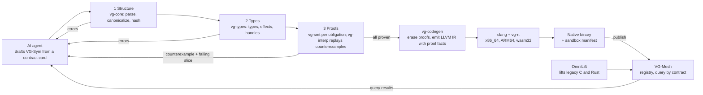

# 01 · Architecture

One Rust workspace of 12 crates shares a single data model. Every path from an AI draft to a binary passes three checks in order: structure, then types and effects, then proofs.

## Crates

| Crate | Job | Phase | Owner | Depends on |
| --- | --- | --- | --- | --- |
| vg-core | Data model, VG-Sym parser and printer, .vgir codec, canonicalizer, BLAKE3 hashing, validator | [MVP] | W1 | — |
| vg-store | Content-addressed object store and index, like .git/objects | [MVP] | W1 | vg-core |
| vg-types | Type checker, effect and capability checker, resource accounting | [MVP] | W2 | vg-core |
| vg-interp | Reference interpreter: the executable semantics and the test oracle | [MVP] | W2 | vg-core, vg-types |
| vg-smt | Verification conditions, SMT-LIB2 emission, solver drivers, counterexamples, proof cache | [MVP] | W3 | vg-core, vg-types, vg-interp |
| vg-codegen | Proof erasure, LLVM IR emission, clang driver, OS sandbox manifests; MLIR later | [MVP]; MLIR [ALPHA] | W4 | vg-core, vg-types, vg-smt |
| vg-rt | Tiny C runtime packaged as a crate: entry point, arenas, capability handles, telemetry | [MVP] | W4 | — |
| vg-decode | Grammar export (Tier 1), incremental checker (Tier 2), SMT guard (Tier 3) | Tiers 1–2 [MVP]; Tier 3 [R-01] | W5 | vg-core, vg-types, vg-smt |
| vg-telemetry | Failing slices and counterexample diffs | [MVP] basic; [R-08] | W2 | vg-core, vg-interp, vg-smt |
| vg-mesh | Registry: store, index, query, ingestion gate, HTTP API | [MVP] local; [R-12] | W6 | vg-core, vg-store, vg-types, vg-smt |
| vg-omnilift | C and Rust to LLVM IR to VG-IR, with equivalence checks | [MVP] lite; [R-03] | W7 | vg-core, vg-types, vg-interp, vg-smt, vg-codegen |
| vg-cli | The `vg` command, plus `vg mcp`, an MCP server any AI agent can call | [MVP] | W5 | all |

## What must be trusted

The trusted computing base is vg-core's canonicalizer and validator, vg-types, vg-smt's VC generator, the SMT solvers, vg-codegen, LLVM/clang, vg-rt and the OS. Everything else is untrusted input: AI output, Mesh submissions, lifted code, and data entering the root node. The reference interpreter is not trusted to be fast, only to be simple and right.

- **Differential testing:** every compiled program runs against vg-interp on generated inputs.
- **Two solvers agree** on release-grade proofs; checkable proof certificates come with R-05.
- **A soundness suite** of known-bad programs must always be rejected, and mutation testing attacks the verifier itself.
- **Reproducible builds:** the same graph gives the same bytes on every machine.
