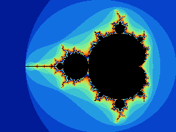

# Example: a verified fractal renderer



`examples/mandelbrot.vgs` draws the Mandelbrot set: 256 × 192 pixels, 64 escape-time steps per pixel,
a 16-colour palette computed with floating-point ramps. It is a small program, but it uses most of
what makes VG-Sym different from C, and every claim below is a proof, not a test:

- the escape loop's step count never passes its cap (a loop invariant);
- the palette is never read out of bounds;
- every float-to-byte conversion of a colour channel fits a byte;
- every pixel of every image, for every view the contract allows, is opaque.

`vg verify` proves all 26 obligations in about a second, and `vg verify --mode release` proves each
one with two solvers that must agree. The same file builds for `aarch64-apple-darwin`,
`wasm32-wasip1` and `x86_64-unknown-linux-gnu` with no runtime check left in, and the native and WASM
executables write the very bytes vg-interp computes.

## The program

```vgsym
// expect: verify
module mandelbrot_guide;

NODE @tick [intent: "One step of the escape loop's counter array"] {
  SIGNATURE: (k: u64) -> (u8);
  EFFECTS: [];
  CONTRACT { }
  BODY {
    RETURN(0:u8);
  }
}

NODE @escape_step [intent: "One Mandelbrot iteration that freezes once the point escapes"] {
  SIGNATURE: (z: Tuple<f32, f32, u32>, t: u8, cr: f32, ci: f32) -> (Tuple<f32, f32, u32>);
  EFFECTS: [];
  CONTRACT {
    PRE: z.2 < 64;
    POST: result.2 <= z.2 + 1;
  }
  BODY {
    %0 = PROJ(z, 0:u32);
    %1 = PROJ(z, 1:u32);
    %2 = PROJ(z, 2:u32);
    %3 = FMUL(%0, %0);
    %4 = FMUL(%1, %1);
    %5 = FADD(%3, %4);
    %6 = LE.f(%5, 4.0:f32);
    %7 = FSUB(%3, %4);
    %8 = FADD(%7, cr);
    %9 = FMUL(%0, %1);
    %10 = FADD(%9, %9);
    %11 = FADD(%10, ci);
    %12 = ADD.checked(%2, 1:u32);
    %13 = SELECT(%6, %8, %0);
    %14 = SELECT(%6, %11, %1);
    %15 = SELECT(%6, %12, %2);
    %16 = TUPLE(%13, %14, %15);
    RETURN(%16);
  }
}

NODE @palette_entry [intent: "Colour j of a 16-entry gradient palette, opaque"] {
  SIGNATURE: (j: u64) -> (u32);
  EFFECTS: [];
  CONTRACT {
    PRE: j < 16;
    POST: result >= 4278190080;
  }
  BODY {
    %0 = CAST.f32(j);
    %1 = FADD(%0, 0.5:f32);
    %2 = FDIV(%1, 16.0:f32);
    %3 = FSUB(1.0:f32, %2);
    %4 = FMUL(%2, %2);
    %5 = FMUL(%4, %2);
    %6 = FMUL(%3, %3);
    %7 = FMUL(%6, %3);
    %8 = FMUL(%3, %5);
    %9 = FMUL(%8, 2295.0:f32);
    %10 = FMUL(%6, %4);
    %11 = FMUL(%10, 3825.0:f32);
    %12 = FMUL(%7, %2);
    %13 = FMUL(%12, 2167.5:f32);
    %14 = CAST.u8(%9);
    %15 = CAST.u8(%11);
    %16 = CAST.u8(%13);
    %17 = CAST.u32(%14);
    %18 = CAST.u32(%15);
    %19 = CAST.u32(%16);
    %20 = SHL.checked(%18, 8:u32);
    %21 = SHL.checked(%19, 16:u32);
    %22 = OR(%17, %20);
    %23 = OR(%22, %21);
    %24 = OR(%23, 4278190080:u32);
    RETURN(%24);
  }
}

NODE @pixel [intent: "The colour of pixel i for a view centred on (cx, cy)"] {
  SIGNATURE: (i: u64, cx: f32, cy: f32, scale: f32, palette: Array<u32, 16>) -> (u32);
  EFFECTS: [];
  CONTRACT {
    PRE: i < 49152 && forall(j in 0..16) { palette[j] >= 4278190080 };
    POST: result >= 4278190080;
    INVARIANT @bounded(k, z): z.2 <= k;
  }
  BODY {
    %0 = MOD.checked(i, 256:u64);
    %1 = DIV.checked(i, 256:u64);
    %2 = CAST.f32(%0);
    %3 = CAST.f32(%1);
    %4 = FSUB(%2, 128.0:f32);
    %5 = FSUB(%3, 96.0:f32);
    %6 = FMUL(%4, scale);
    %7 = FADD(cx, %6);
    %8 = FMUL(%5, scale);
    %9 = FSUB(cy, %8);
    %10 = GENERATE(@tick, 64:u64);
    %11 = TUPLE(0.0:f32, 0.0:f32, 0:u32);
    %12 = FOLD_BOUNDED(@escape_step, %10, %7, %9, init=%11, invariant=@bounded);
    %13 = PROJ(%12, 2:u32);
    %14 = CAST.u64(%13);
    %15 = AND(%14, 15:u64);
    %16 = INDEX(palette, %15);
    %17 = EQ(%13, 64:u32);
    %18 = SELECT(%17, 4278190080:u32, %16);
    RETURN(%18);
  }
}

NODE @render [intent: "Render a 256 x 192 view of the Mandelbrot set as RGBA pixels", export] {
  SIGNATURE: (cx: f32, cy: f32, scale: f32) -> (Array<u32, 49152>);
  EFFECTS: [];
  CONTRACT {
    PRE: cx >= -2.5 && cx <= 1.5 && cy >= -1.5 && cy <= 1.5 && scale > 0.0 && scale <= 0.02;
    POST: forall(i in 0..49152) { result[i] >= 4278190080 };
  }
  BODY {
    %0 = GENERATE(@palette_entry, 16:u64);
    %1 = GENERATE(@pixel, 49152:u64, cx, cy, scale, %0);
    RETURN(%1);
  }
}
```

The file in `examples/` carries comments; this copy drops them, and CI verifies both.

## How it is put together

**There are no loops, only combinators with visible bounds.** `@render` builds the image with
`GENERATE`, which calls the kernel `@pixel` once for each index below 49,152. `@pixel` iterates
z ← z² + c with `FOLD_BOUNDED` over a 64-element array: the array's length is the loop bound, so
termination is never in question. `@escape_step` stops changing z once |z|² passes 4, so the count it
carries is the escape time.

**Each pixel is one `u32` in RGBA order.** On a little-endian machine the bytes of `0xFFBBGGRR` are
red, green, blue and alpha, so the 196,608 bytes of the result are an RGBA image as they stand: a
browser canvas takes them directly.

**Kernels are pure and fixed-size.** `@tick`, `@escape_step`, `@palette_entry` and `@pixel` have no
effects and only fixed-size types, which is what lets `GENERATE` and `FOLD_BOUNDED` call them (docs/14).
Nothing in the program allocates or touches the outside world, so its effect set is empty.

## What the verifier proves

| Obligation | What it means |
| --- | --- |
| `@pixel/…/FOLD.base`, `FOLD.pre.0`, `FOLD.step` | The invariant `count <= k` holds before the loop, implies the step's PRE (`count < 64`, so `ADD.checked` cannot overflow), and survives each step. After 64 steps the count is at most 64. |
| `@pixel/…/INDEX.in_bounds` | `count AND 15` is below 16, the palette's length. Both arms of a `SELECT` are evaluated, so the palette is read even for black pixels: the index must be safe on every path, and it is. |
| `@palette_entry/…/CAST.in_range` (three) | Each channel, a polynomial such as 255 · 9 (1 − t) t³ in f32, is finite, not NaN and below 256, so the conversion to a byte is exact truncation, never an overflow. The solver proves this over every float the computation can produce, not over a few samples. |
| `@pixel/…/DIV.nonzero`, `MOD.nonzero` | The pixel's row and column come from divisions by a non-zero constant. |
| `@render/…/GEN.pre.0`, `GEN.pre.1` | Every call of `@palette_entry` and `@pixel` meets their PRE, for an arbitrary index: the fresh-element rule of docs/05. |
| `@render/POST.0` | Every pixel of every image is opaque, for every view PRE allows. |
| `…/NONVACUOUS` | Each contract can be met, so none of the proofs above holds vacuously. |

PRE on `@render` does not protect any op here: float arithmetic never traps. It states the views the
renderer is meant for, and a built executable checks it on entry, so a NaN centre or a zoom-out past
the set exits with code 1 instead of drawing nonsense.

## Run it

```bash
vg verify examples/mandelbrot.vgs --mode release
vg run examples/mandelbrot.vgs @palette_entry '{"j": 5}'
vg build examples/mandelbrot.vgs @render --target aarch64-apple-darwin --target wasm32-wasip1
```

The executable reads the view as three little-endian f32 (12 bytes: centre x, centre y, units per
pixel) and writes 196,608 bytes of RGBA:

```bash
python3 -c 'import struct,sys; sys.stdout.buffer.write(struct.pack("<3f", -0.75, 0.0, 0.013671875))' \
  | target/vg/render-aarch64-apple-darwin > mandelbrot.rgba
```

On an Apple M-series Mac the native executable draws a frame in about 10 ms, start-up included.
`wasmtime run target/vg/render-wasm32-wasip1` gives the same bytes, and
`crates/vg-cli/tests/graphics_example.rs` checks both against vg-interp in CI.

## Break it

Change the red ramp's scale from 2295 (255 × 9) to 3000, and the verifier finds the colour that no
longer fits a byte:

```text
@palette_entry/%14/CAST.in_range  counterexample  {"j": "12"}  reproduced: concrete
```

At j = 12, t = 0.78125 and the red channel would be 312. Index the palette with `count AND 31`
instead of `AND 15`, and `INDEX.in_bounds` is refuted. A C version of either bug compiles and runs:
one converts an out-of-range float to a byte, which is undefined behaviour, and the other reads past
the end of the palette.
